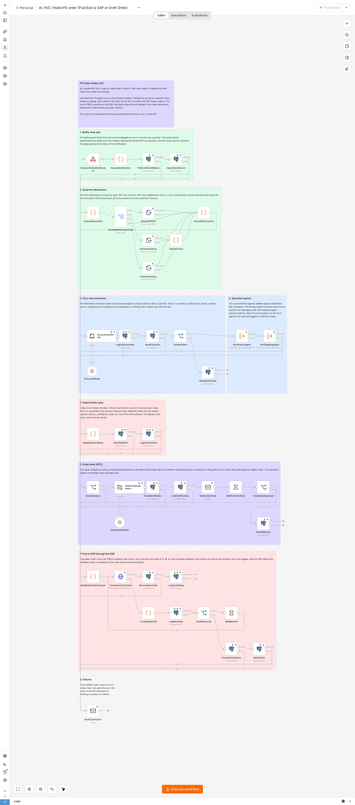
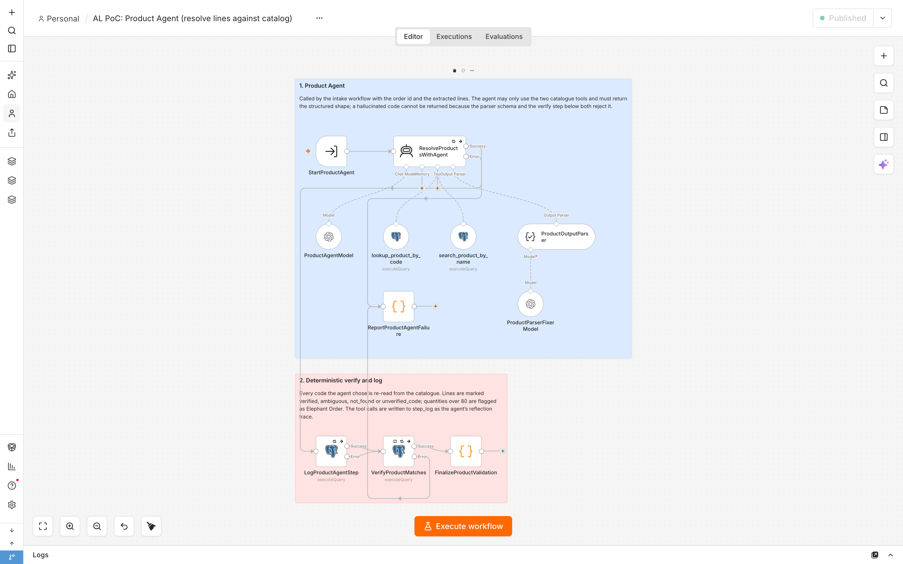
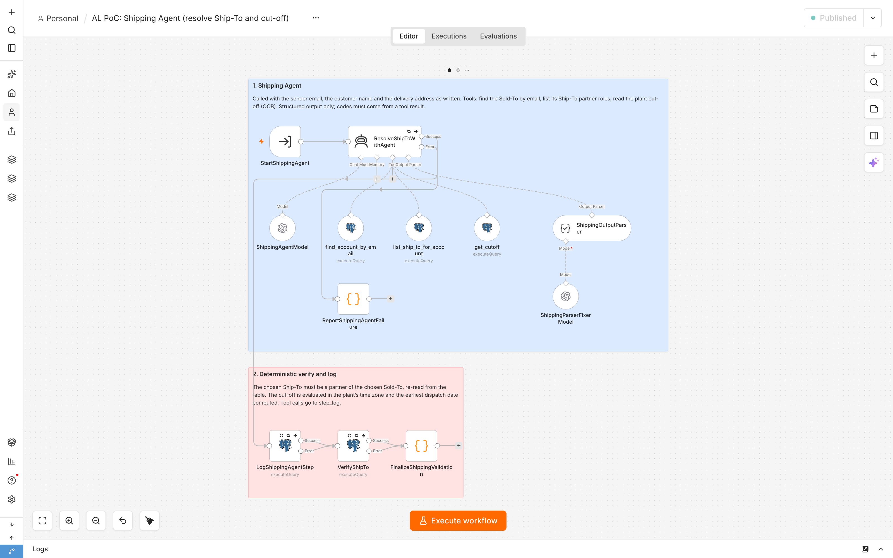
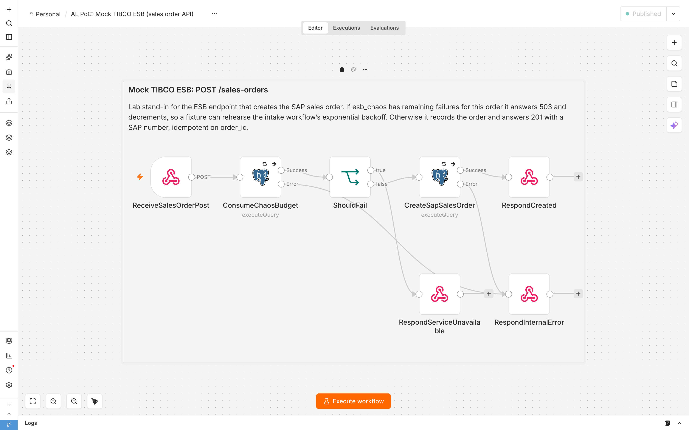
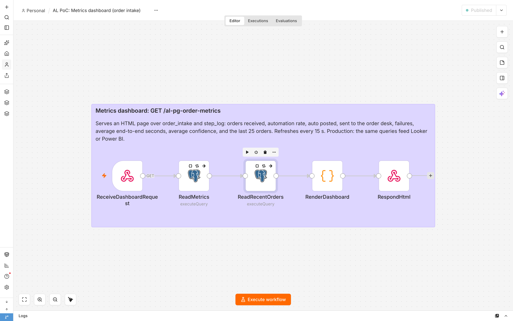

# Air Liquide RFP PoC: PG Order Intake on n8n

Lab build of the order-to-cash use case from the Air Liquide RFP (2026-06-30, PoC
window 2026-10-12 to 2026-11-30). A customer email arrives, an agentic pipeline
extracts the order, validates it against Salesforce data, and either creates the SAP
sales order through the TIBCO ESB or parks a pre-filled Draft Order for the order
desk. Everything here runs on the local lab with synthetic data and stand-ins; the
real connectors are swapped in once Air Liquide grants access.

Built 2026-10-16 on n8n 2.35.5. All five workflows are published on the lab and the
five fixtures pass end to end.

## Architecture

```
Gmail + Pub/Sub ──notify──▶ Intake (webhook, ack at once)
                              │ pull email + attachment from the mailbox
                              │ Extract from File (PDF / XLSX / CSV)
                              │ Information Extractor (zero-shot, fixed schema)
                              ├──▶ Product Agent  (catalogue tools, verify, step_log)
                              ├──▶ Shipping Agent (Sold-To, Ship-To, cut-off, verify, step_log)
                              │ deterministic gate (C1-C6, R7-R9, I10)
                     ┌────────┴────────┐
                 auto                 draft
                     │                   │ LLM-written note, draft_orders row,
                     │                   │ order-desk email with Approve / Reject links
                     │                   │ Wait (resume on click)
                     ▼                   ▼
              POST TIBCO ESB  ◀──── approved
              backoff 4/8/16/32/64 s, 5 tries, then escalate to the desk
                     │
                     ▼
              SAP sales order number on the order record
```

Design rules that shape every workflow:

- **Agents resolve, code decides.** The two agents may only return codes that came
  out of a tool call, the structured output parser enforces the shape, and a verify
  query re-reads every code from the table. The gate is a Code node; no model votes
  on posting an order.
- **Every step is logged.** `step_log` carries each agent tool call, the extraction,
  the rule results, the decision and every ESB attempt. The dashboard and the RFP's
  automation-rate / execution-time / confidence metrics read from it.
- **Notify, then pull.** The Pub/Sub payload is a pointer, acknowledged on receipt.
  The email and its attachment are fetched afterwards.
- **One attachment per email** in PoC scope. DOCX and scanned PDFs are routed to
  Document AI on the customer instance, not here.

## Workflows

Ids on the lab are in `deploy/workflows.dev.json`. Tags: `al-poc`, `pg-order-intake`.

### 1. Intake PG order (Pub/Sub to SAP or Draft Order)

42 nodes in eight zones. The whole order-to-cash path for one email.



| Zone | Nodes | What happens |
|---|---|---|
| Notify, then pull | Webhook `POST /webhook/al-pg-order-notify`, Code, Postgres x2 | Ack the notification, decode the pointer, pull the mailbox row, open the `order_intake` record |
| Read the attachment | Code, Switch, Extract from File x3, Code x2 | Route the first attachment by type (pdf / xlsx / csv / none), flatten rows to text, join with the body into one document |
| Zero-shot extraction | Information Extractor + model, Postgres x2, If, Postgres | Fixed schema: intent, customer, Ship-To as written, product lines, empty returns, reasoning, confidence. Non-orders stop here as `not_an_order` |
| Specialist agents | Execute Sub-workflow x2 | Product Agent, then Shipping Agent, each returning verified codes |
| Deterministic gate | Code, Postgres x2 | C1-C6 critical (intent, account, every code, Ship-To, quantities, email match); R7 Elephant Order over 80 units; R8 empty cylinder returns; R9 confidence under 0.7; I10 cut-off informational |
| Order desk (HITL) | If, Basic LLM Chain, Postgres x2, Send Email, Wait, If, Postgres | Draft Order row with an AI-written note (fixed wording from the gate reasons), Approve / Reject links built from `$execution.resumeUrl`, execution sleeps on the Wait |
| Post to SAP through the ESB | Code, HTTP Request, Postgres x2, Code, Postgres, If, Wait, Postgres x2 | One sales-order call; on 5xx the loop waits 4, 8, 16, 32, 64 s (`$runIndex` counts attempts), each attempt logged; after the fifth failure the order is escalated to the desk and marked failed |
| Failures | Send Email | Every fallible node's error output lands here; ops gets the error, order id and execution id |

### 2. Product Agent (resolve lines against catalog)

AI Agent 3.1 with two Postgres tools (`lookup_product_by_code`,
`search_product_by_name`), a structured output parser with auto-fix, then a
deterministic verify and `step_log` insert.



Lines come back as `verified`, `ambiguous`, `not_found` or `unverified_code`.
Quantities over 80 are flagged Elephant Order. A `resolved` match must also pass a
lexical check in code: the catalogue name or an alias is at least 60 % covered by the
customer's own words, or the code was written verbatim; otherwise it is downgraded to
`ambiguous`. That check exists because the lab model translates French and German
product words to English before searching and once matched "Detendeur oxygene 200 bar"
to the oxygen cylinder instead of the regulator.

### 3. Shipping Agent (resolve Ship-To and cut-off)

Same shape with three tools: `find_account_by_email`, `list_ship_to_for_account`,
`get_cutoff`. The verify step re-reads that the chosen Ship-To is a partner of the
chosen Sold-To, evaluates the plant cut-off in its own time zone and computes the
earliest dispatch date.



### 4. Mock TIBCO ESB (sales order API)

Lab stand-in for `POST /sales-orders`. If `esb_chaos` holds remaining failures for the
order it answers 503 and decrements, so a fixture can rehearse the backoff. Otherwise
it records the order and answers 201 with a SAP number, idempotent on `order_id`.



### 5. Metrics dashboard (order intake)

`GET /webhook/al-pg-order-metrics` serves an HTML page over `order_intake` and
`step_log`: orders received, automation rate, auto posted, sent to the desk, failures,
average end-to-end seconds, average confidence, last 25 orders. Refreshes every 15 s.
On the customer instance the same queries feed Looker or Power BI.



## Lab stand-ins

| Production (RFP) | Lab |
|---|---|
| Gmail + Google Pub/Sub | `mailbox` table + `scripts/send-fixture.py` posting the notification |
| Salesforce (accounts, partner roles, catalogue, Draft Orders) | `accounts`, `partner_roles`, `product_catalog`, `draft_orders` tables |
| OCB cut-off API | `cut_offs` table |
| TIBCO ESB to SAP S/4HANA | Mock TIBCO ESB workflow + `sales_orders`, `esb_chaos` |
| Gemini / Vertex AI | LM Studio `qwen/qwen3-coder-30b` on the host, OpenAI-compatible |
| Order desk mailbox | Mailpit SMTP |
| Dashboards (Looker) | Metrics dashboard workflow |

Schema and seed: `data/schema.sql`, `data/seed.sql`. Three accounts, four Ship-Tos,
nine products with multilingual aliases, two plant cut-offs (France 23:59 Paris,
Germany 09:00 Berlin).

## Running it

Prerequisites: the lab n8n in podman at `localhost:5678`, the `pg-lab` container,
Mailpit, LM Studio serving the model on port 1234, and the Infisical CLI with access
to project n8n-FDE (env dev). All scripts are standard library only.

```sh
# one time: database, role, n8n credential
infisical run --projectId <id> --env dev --silent -- python3 scripts/lab-setup-db.py
python3 scripts/make-fixture-files.py

# deploy, sub-workflows first (n8n refuses to publish a caller whose targets are unpublished)
for f in al-mock-tibco-esb al-product-agent al-shipping-agent al-pg-order-intake al-metrics-dashboard; do
  infisical run --projectId <id> --env dev --silent -- ./scripts/with-lab.sh ./scripts/deploy.sh workflows/dev/$f.json dev --activate
done

# send a fixture, watch it finish
python3 scripts/send-fixture.py data/fixtures/f1-durand-clean-order.json
python3 scripts/watch-order.py <order_id>
python3 scripts/send-fixture.py data/fixtures/f5-durand-esb-retry.json --chaos 2
```

Dashboard: `http://localhost:5678/webhook/al-pg-order-metrics`. Order-desk mail:
Mailpit UI.

The workflow JSON is generated. Edit `workflows/src/build_pg_order_intake.py`, rebuild,
run the canvas layout tool with the matching `workflows/src/zones_*.json`, then deploy.
Never hand-edit the JSON.

## Results (2026-10-16)

| Fixture | Path | Outcome | Time |
|---|---|---|---|
| f1 French body, two lines | auto | SAP order | 28 s |
| f2 German body, XLSX, past Berlin cut-off | auto | SAP order, cut-off noted | 17 s |
| f3 PDF, qty 100, unknown product, 40 empties | draft | Draft Order with three reasons; Approve link posted | 25 s to desk |
| f4 price inquiry | stop | `not_an_order` | |
| f5 ESB 503 twice (`--chaos 2`) | auto | 503, 4 s, 503, 8 s, posted on attempt 3 | |

RFP success criteria covered on the lab: under 5 minutes per order, deterministic
match on intent / Ship-To / email / codes / quantities, confidence gate at 0.7,
five retries over about two minutes on 5xx before escalation, reflection logs and
metrics.

## Open items

- Gmail + Pub/Sub path on the Air Liquide EC2 (network, service account) and the
  Citrix accesses. Prerequisites draft in `docs/POC-PREREQUISITES.md`.
- TIBCO and Salesforce API contracts (payload shape, Draft Order object, auth).
- The seventeen golden PG orders for evaluations, and Air Liquide's anonymised sample
  (lands under `data/fixtures/al/`, gitignored).
- DOCX and multi-attachment emails.
- Gemini via Vertex AI in place of LM Studio; re-check the lexical guard against it.

See `CLAUDE.md` for contacts, instance map and conventions, `docs/RFP-BRIEF.md` for
the requirement digest and the answer-grid commitments, `docs/RUNBOOK.md` for
operations, `docs/HANDOFF.md` for the phase handoff.
